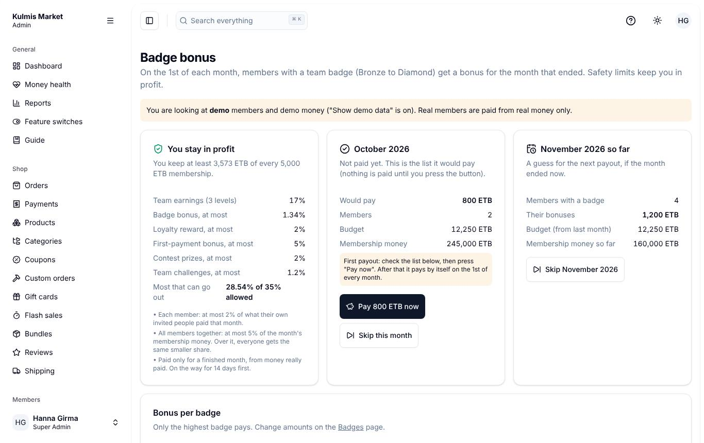

**Badges**: members unlock them for their team, loyalty, earnings and orders. Team badges (Bronze to Diamond) can pay a monthly bonus.

**Monthly badge bonus** (on the 1st, for the month that ended)
1. **Badge bonus** shows a preview: who would get what, and any limit that cut it.
2. **Pay now** — or **Skip this month** (nobody gets it; logged).
3. Members see *"Bonus adjusted this month"* when the budget cut it.

Who gets it: the member's own membership was paid every day of the month, and only their **highest** badge pays. Limits keep you in profit (a monthly budget and a per-member limit in Settings → Badge bonus).

**Other rewards**
| Reward | Value | Paid when |
|---|---|---|
| First-payment bonus | {first_payment_bonus} | to the inviter, when someone they brought pays the first time |
| Loyalty reward | {loyalty_reward} every {loyalty_months} months | to members who stay |
| Contests | fixed prizes for places 1–10 | after the contest ends, from real payments only |
| Team challenges | e.g. "bring 3 paying members this month" | after the month, within a monthly limit |

**The 35% guard**: you can't save prices, rates or bonuses that could pay members more than 35% of a membership. You always keep at least 65%.
