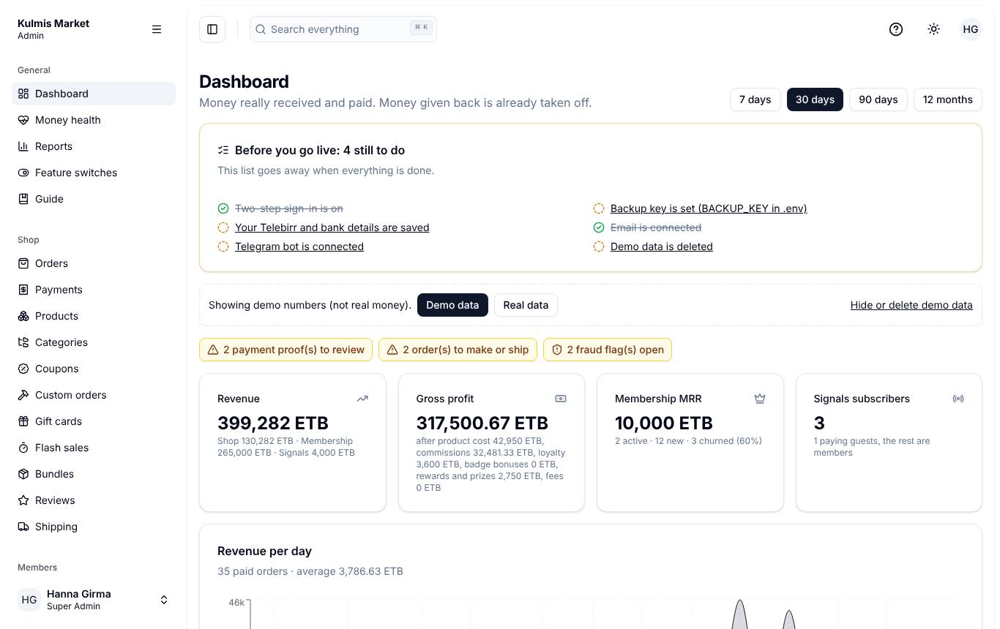
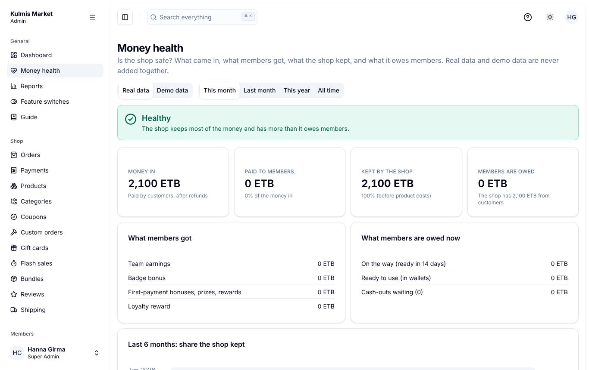

**Dashboard**: money really received and paid in the time you pick (7 days to 12 months). Refunds are already taken off.

- The yellow boxes at the top are **today's work**: receipts to check, orders to make or ship, fraud checks. Tap one to open it.
- **Demo data / Real data** switches between the example numbers and your real shop. They are never added together.
- **Revenue**, **Gross profit** (after product cost, team earnings, bonuses and fees), **Membership MRR** (money from memberships every month), **Signals subscribers**.

**Money health** answers one question: *is the shop safe?*

| Light | What it means | What to do |
|---|---|---|
| 🟢 Green | Members got 25% or less of the money in, and the shop has more than it owes | Nothing |
| 🟡 Yellow | Members got more than 25%, **or** a cash-out waited longer than {payout_days} days | Pay late cash-outs today. Look at Settings → Referral and Badge bonus |
| 🔴 Red | Members got more than 35%, **or** members are owed more than the shop received, **or** a money rule is broken | Stop and check: the reasons are listed under the light. Pause bonuses (Badge bonus → Skip this month) until it is green again |

- **Members are owed** = on the way + ready to use + cash-outs waiting. Keep at least this much money in your account.
- **What if…**: type how many members you start with and how many paying people each brings. It shows the money in, what members get and what you keep, from your real settings. A guide, not a promise.

**Check**: every day the yellow boxes; every week Money health; every month Money health "Last month".
