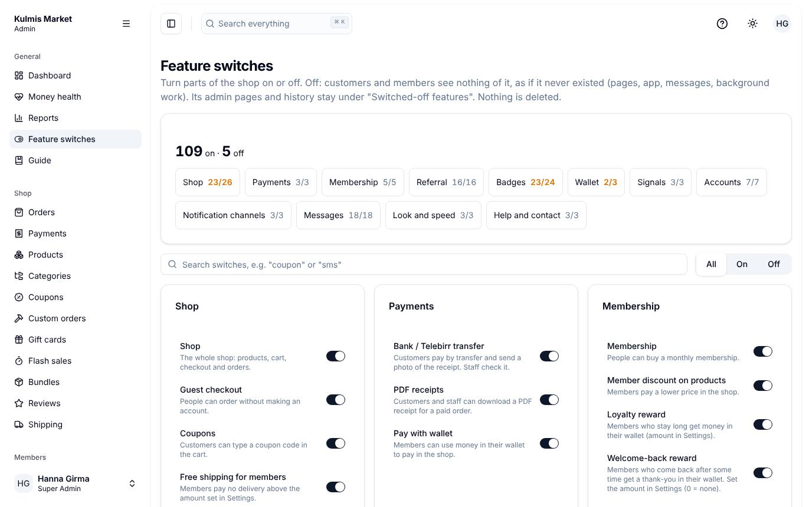

Every part of the shop has a switch with a short description. **Off = customers never see it**, as if it never existed: no menu, no page, no words about it.

**Groups**: Shop, Payments, Membership, Referral, Badges, Wallet, Signals, Accounts, Messages, Help and contact, Site.

**Before switching off**, the page shows what it means, for example *"37 people have signals until their month ends"* or *"3 cash-outs are waiting"*. Read it, then confirm.

- People who **already paid** keep what they paid for (membership, signals) until their time ends. **End access now** ends it early (optionally with money back to the wallet).
- Admin screens of a switched-off feature move to the end of the menu, so you can finish open work.
- **Texts that mention a switched-off feature** are listed, so you can fix them.

**Always sent, whatever the switches say**: safety messages (new sign-in, password changed, email changed, cash-out account changed, two-step sign-in on/off, cash-outs).

