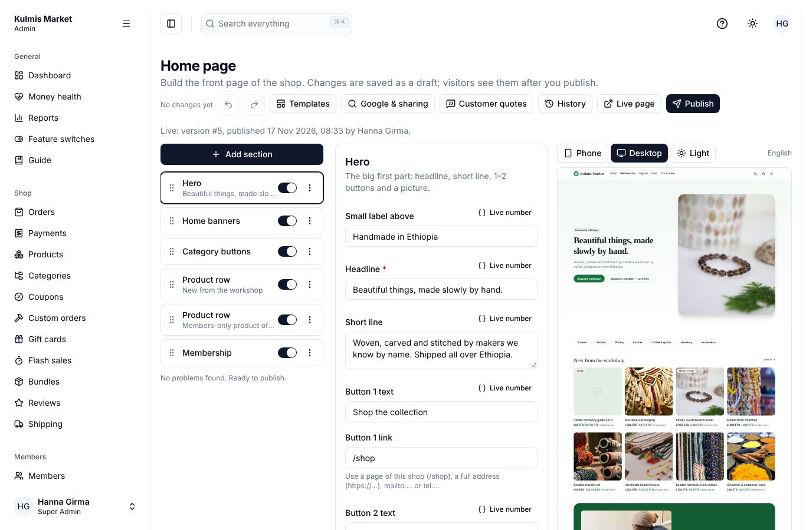
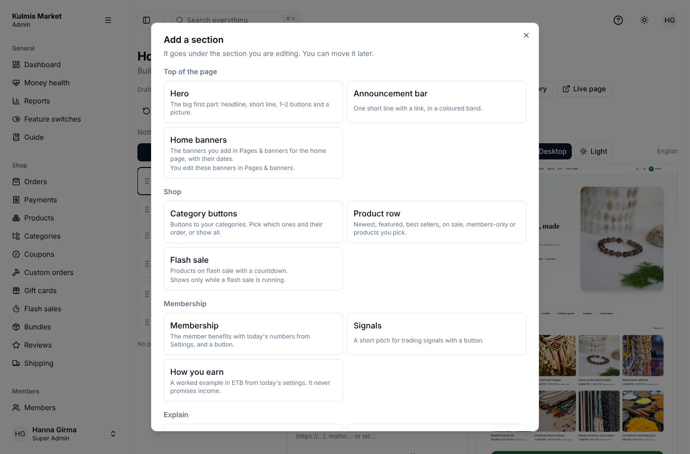
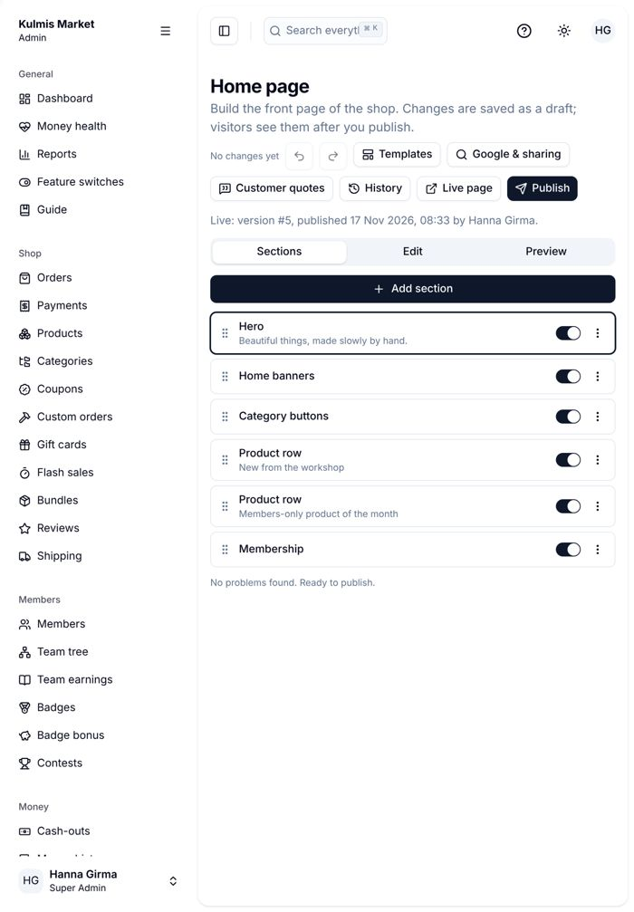
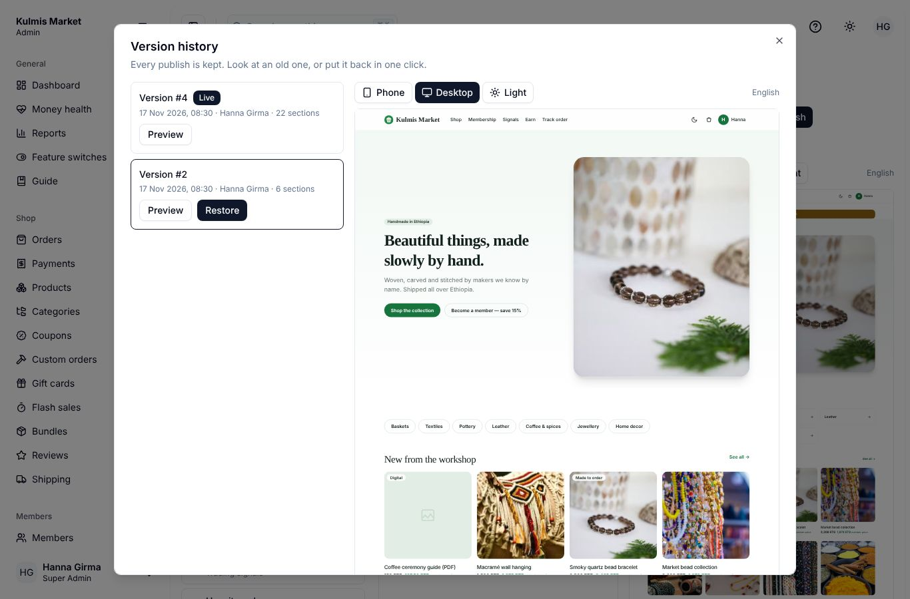

**Admin → Home page** builds the front page of the shop, without code. Only you (Super Admin) and the **Content editor** role can change it.

**How it works**
1. Every change is saved by itself as a **draft** ("Draft saved" at the top). Visitors do not see the draft.
2. The **preview** on the right updates as you type. Switch **Phone / Desktop** and **Light / Dark** above it.
3. **Publish** puts the draft live. Cached pages are cleared, so visitors see it right away. Or tick **Publish later** and pick a date and time: it goes live by itself (checked every minute).
4. **Discard draft** throws your changes away and goes back to the live page.
5. **History**: every publish is kept with who and when. **Preview** an old one, or **Restore** it in one click (your draft is kept).

Until you publish the first time, visitors see the fixed home page. The draft starts as an exact copy of it, so publishing without changes changes nothing. The switch **Home page builder** (Switches → Look and speed) turned off also shows the fixed page.

**Sections** (left column)
- **Add section** opens the library: Hero, Announcement bar, Home banners, Category buttons, Product row, Flash sale, Membership, Signals, How it works, How you earn, Maker stories, Picture + text, What customers say, Trust numbers, Questions, Video, Gallery, Call to action band, Contact, Space / line.
- **Drag** the dots to move a section (on a phone: hold, then drag; with a keyboard: Space, arrows, Space). The **⋮** menu also has Move up / down, **Duplicate** and **Delete**.
- The switch on each row shows or hides it without deleting it.
- **Greyed out** = its feature is off (for example Signals): it hides by itself and comes back when you turn the feature on. A Flash sale section shows only while a sale is running.
- **Undo / Redo** (or Ctrl+Z / Ctrl+Shift+Z) for any change, also after a template.

**Editing** (middle column): pick a section to change its texts, buttons (text + link), pictures, colour and layout.
- **Live number** next to a text adds today's number from Settings (membership price, member discount, free delivery from…). Change the setting and the page changes too. You never type a price.
- Links can be a page of the shop (`/shop`, `/membership`), a full address (`https://…`), `mailto:` or `tel:`. Other links are refused. A button whose page is switched off is not shown.
- **Pictures**: upload once, then pick them anywhere. A short description (alt text) is required, for people who cannot see the picture. Uploads are made smaller (AVIF, WebP, JPEG) and the camera data (like the place) is removed.
- **Colours**: the ready colours always read well. With **My colour** you get a warning when the text would be hard to read.
- **Video**: a YouTube or Vimeo link, or a short file (up to 2 minutes, 15 MB). It loads only when someone taps play, so the page stays fast.

On a phone or tablet the screen has three tabs: **Sections**, **Edit** and **Preview**.

**Customer quotes**: type in what real customers told you (name, town, words, a photo if they agree). A quote shows only after you tick **A real customer said this**; a photo only with **They said yes to showing their photo**. Never write quotes yourself.

**Trust numbers** are counted from your real orders, products and members. A number that is 0 is not shown.

**Templates**: Current home page, Shop first, Membership first, Story first, and **Investor demo** (every section with demo photos and quotes marked "Demo"; needs Show demo data on). A template replaces the sections of the draft; Undo brings yours back.

**Google & sharing**: the page title, description and the picture shown when someone shares the link on Telegram or WhatsApp.

**Before publishing** the list under the sections shows what to fix (red: publishing waits) and what to check (orange: you can still publish), for example a missing description or no Hero at the top.

**Common mistakes**: writing a price by hand instead of a live number; a button with text but no link (it is not shown); a quote without the tick (it is not shown).
