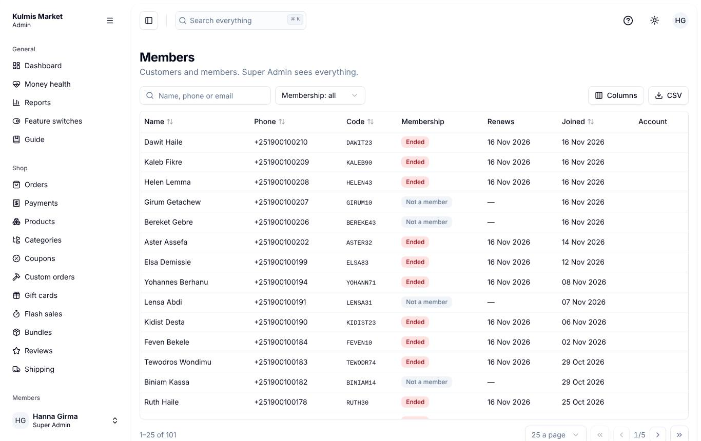

**Members**: search by name, phone or email. Open a member to see their membership, wallet, team and history.

**Membership**
- Price **{membership_price}** per month. It starts when the payment is approved.
- **Renewing early** adds the new month after the current one.
- **Grace period**: {grace_days} days after the end, everything still works. Then it ends.
- We remind members before the end, on the last day and after the end.

**On a member page**
| Button | What it does |
|---|---|
| Membership → **Extend membership by … days** / **End membership now** | Fix a membership by hand (with a reason, logged) |
| Wallet → **Adjust available wallet** | Add or take money by hand (with a reason, logged) |
| Referral → **Change referrer** | See [Referrals](daily-referrals.md) |
| **Suspend account** / **Re-activate account** | Stop sign-in and earnings, e.g. for cheating |

**End access now** (for everyone): when you switch **Membership** off in Feature switches, paid members keep their benefits until their month ends. Under the switch, **End access now** ends it for everyone; tick **Add the days they did not use to their wallet** to be fair.

