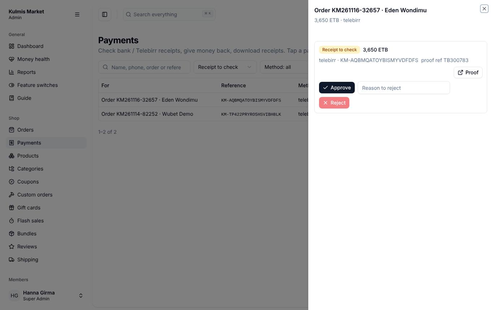

**Order steps**: Waiting for payment → **Paid** → **Making** → **Shipped** → **Delivered** (or Cancelled). The customer gets a message at every step.

**Approve a bank or Telebirr receipt** (every day)
1. **Payments** (the list starts with *Receipt to check*). The **For** column says what it is for and who paid, e.g. *Membership · Sara Tesfaye* or *Order KM… · Abebe*.
2. Open it → **Proof** to see the photo. Check the amount, the date and the reference in your Telebirr or bank app.
3. Right: **Approve**. Wrong: type a reason (e.g. *The amount is 500 ETB, not 5,000 ETB*) → **Reject**. The customer sees the reason and can send a new receipt.

**Ship an order**: Orders → open it → **Mark making** → choose a **Courier**, type the tracking number → **Mark shipped** → **Mark delivered** when it arrives.

**Refund**
1. Payments → **Filters** → Status: **all** → search the name, phone or order number → open the payment.
2. **Refund…** → amount → reason → **Refund**.
3. Send the money back by Telebirr or bank yourself (wallet payments go back to the wallet automatically).

What a refund does: the team earnings and bonuses from that payment are **taken back** from everyone. If a member already used that money, the refund box warns you, and their wallet shows a minus until their next earnings cover it. For orders you can choose **Put items back in stock**.

**Shipping**: zones (cities), prices by weight, couriers and their tracking links.

**Check**: every day receipts and orders to ship; unpaid orders are cancelled by themselves after {unpaid_cancel_hours} hours.
