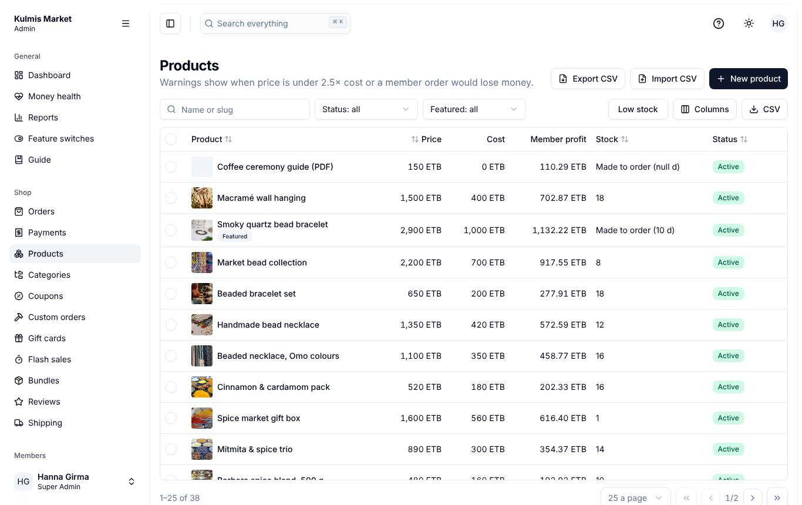

**Add a product**: Products → **Add product** → name, price, cost (materials + labour), stock, photos, category → Save.
- **Sizes or colours**: add variants; each has its own stock (and price if you want).
- **Early access**: new products are for members first for {early_access_hours} hours.
- **Members-only**: everyone sees it, only members can buy.
- **Digital product**: upload the file; buyers get a download link by message. Never "sold out".
- **Pre-order**: customers pay a part now and the rest before shipping.
- The page warns you when the price is too low compared to the cost.

**Stock**: the shop takes stock when an order is placed, so two people can't buy the last piece. You get a warning when stock is low. Bulk edit and CSV import are on the Products page.

**Promotions**
| Page | What |
|---|---|
| Coupons | A code for % or an amount off. The shop never lets a coupon make an order lose money. |
| Flash sales | A lower price for a time, with an optional number of pieces and a countdown |
| Bundles | Several products together at one price |
| Gift cards | Codes people buy for others. Selling one for cash in the shop needs a Manager or you |
| Reviews | Approve or hide customer reviews |
| Custom orders | A customer asks → you send a price → they pay a deposit → you make it → they pay the rest |

**Common mistakes**: no cost filled in (profit numbers are wrong); selling a variant product with stock on the product instead of on each variant.
