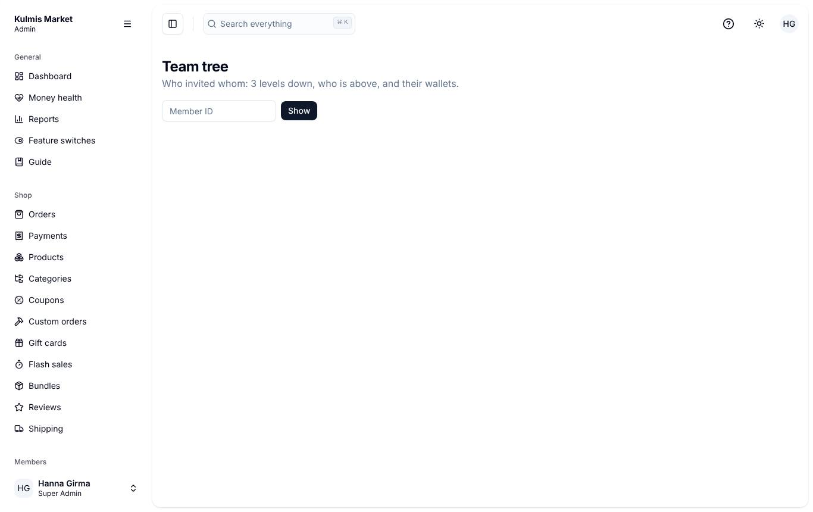

**The 3 levels** (on each {membership_price} membership):

| Level | Who | Share | Earning |
|---|---|---|---|
| 1 | people the member invited | {l1_rate} | {l1_amount} |
| 2 | people they invited | {l2_rate} | {l2_amount} |
| 3 | the next level | {l3_rate} | {l3_amount} |

On shop orders: {shop_l1_rate} / {shop_l2_rate} / {shop_l3_rate} of the goods (no delivery).

**Example**: Abdi invites Sara; Sara invites Hana; Hana invites Omar. When Omar pays {membership_price}: Hana gets {l1_amount}, Sara {l2_amount}, Abdi {l3_amount}. If one of them is not an active member, their part is **not** passed up: the shop keeps it.

**Rules**
- Earnings are **on the way** for {pending_days} days, then **ready to use**.
- Only active members earn. Buying from yourself never pays.
- **Locked referrer**: who invited someone is fixed at sign-up. Later links don't change it.
- **Changing a referrer**: only you (Super Admin). Members → open the member → Referral → **Change referrer** → type a reason. It is logged. Loops are refused.

**Team tree**: search a member to see 3 levels down and who is above them, with wallets.

**Team earnings**: every earning with its status (on the way, ready, taken back, on hold).

