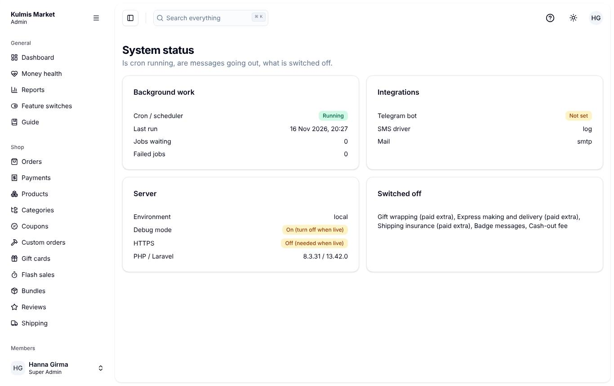

**Reports**: sales, products, members, earnings by level and type, discounts, shipping. Pick the dates. Every table has **CSV** (all rows) and **CSV of selected**.

**Status** (system health): environment, HTTPS, debug mode, background work (the last time the cron ran), jobs waiting or failed, mail, SMS, Telegram. Something red → fix it today.

**km:doctor** (on the server):
```
php artisan km:doctor
```
- Red ✘ = unsafe. Fix it before anything else.
- Yellow ! = setup missing (works, but something won't happen).

**Backups**: see [Backups and restore](setup-backups.md).


