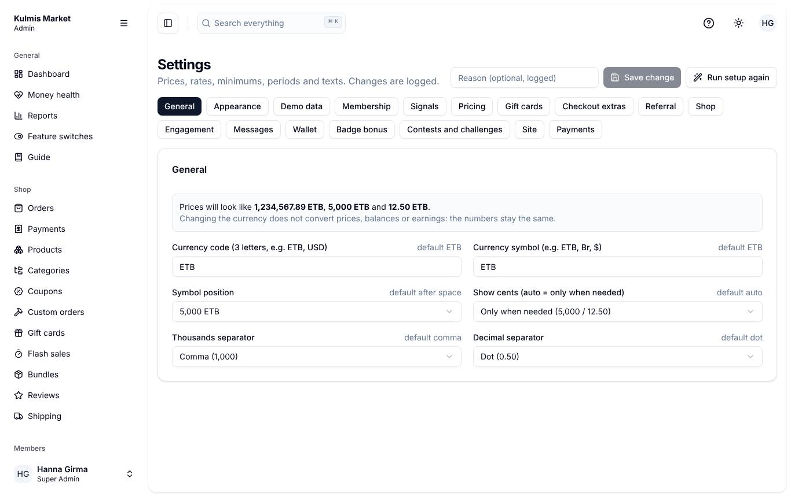
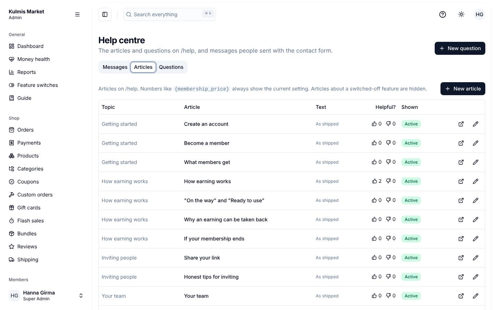

**Settings** has groups: General (currency), Appearance, Membership, Signals, Pricing, Referral, Wallet, Badge bonus, Contests and challenges, Engagement, Site, Messages, Payments.
- Every change is **logged** with who and when. Type a reason if you want.
- **Money** is typed in birr; percentages in %.
- **Currency**: changing it does **not** convert prices or balances, only the symbol and format. You are asked to confirm.
- **Run setup again** opens the 5-page setup wizard.

The money rules right now are in the [Quick reference](quick-reference.md).

**Pages & banners**: terms, privacy, refunds, membership terms, referral rules, and banners (top bar, home).

**Share kit**: the ready-made posts members can share.

**Help centre**: messages from the contact form, the help **Articles** (change, hide, reset, add; with the *Was this helpful?* counts) and the **Questions**.

**Demo data**: show or hide it, or **delete all of it** before you go live.

