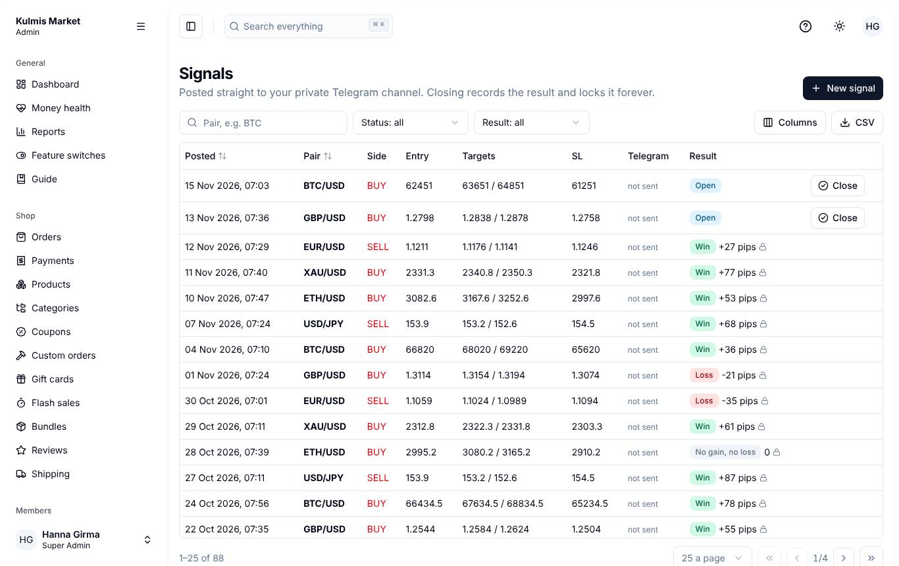

Members get signals included. Guests pay **{signals_price}** per month.

**Post a signal**: Signals → **New signal** → pair, direction, entry, targets, stop loss, notes → it is posted to the channel. You can edit it while it is open.

**Close it**: **Close** → result (win, loss, breakeven, cancelled), value, note. The result is posted as a reply. After closing it is **locked** for ever (honest results). The public results page shows the win rate.

**Subscribers**: see who has access and until when. **Add** someone for some days (with a reason) or **Remove now**.

**Telegram bot**: shows if the bot and the webhook work. Not working? See [Connect Telegram](setup-telegram.md).

**Common question**: *"Telegram didn't add someone"* → see [Problems and answers](problems.md).
