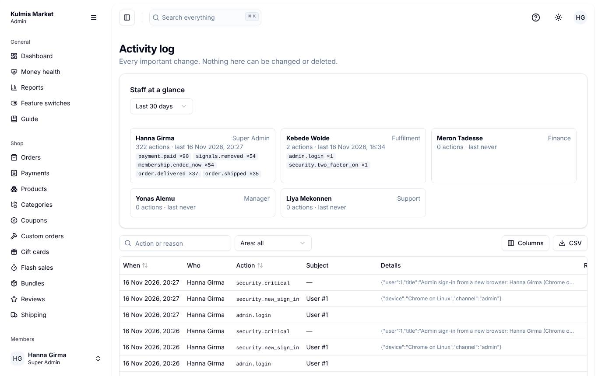

**Roles**
| Role | Can do |
|---|---|
| Super Admin (you) | everything |
| Manager | products, orders, members, signals, pages, reports, approve receipts |
| Finance | money history, cash-outs, approve receipts, fraud checks, reports |
| Fulfilment | orders and shipping |
| Support | orders and members, help messages |

**Add staff**: on the server, `php artisan km:create-admin name@example.com --role=finance --first=Name --last=Surname`. They must set up two-step sign-in at their first sign-in.

**Two-step sign-in** is required for all staff. Lost phone? Use a recovery code. No codes left? See [Problems and answers](problems.md).

**My account**: your password, two-step sign-in and **Sign out other devices**.

**Activity log**: every important action (approvals, refunds, setting changes, switches…). Filter **Security** for sign-ins, wrong passwords and 2FA changes. Nothing in it can be changed or deleted. Routine security events are kept 13 months; money records for ever.

**Extra lock**: put your own internet address(es) in `ADMIN_ALLOWED_IPS` in `.env`; everyone else gets *not found* for `/admin`.

