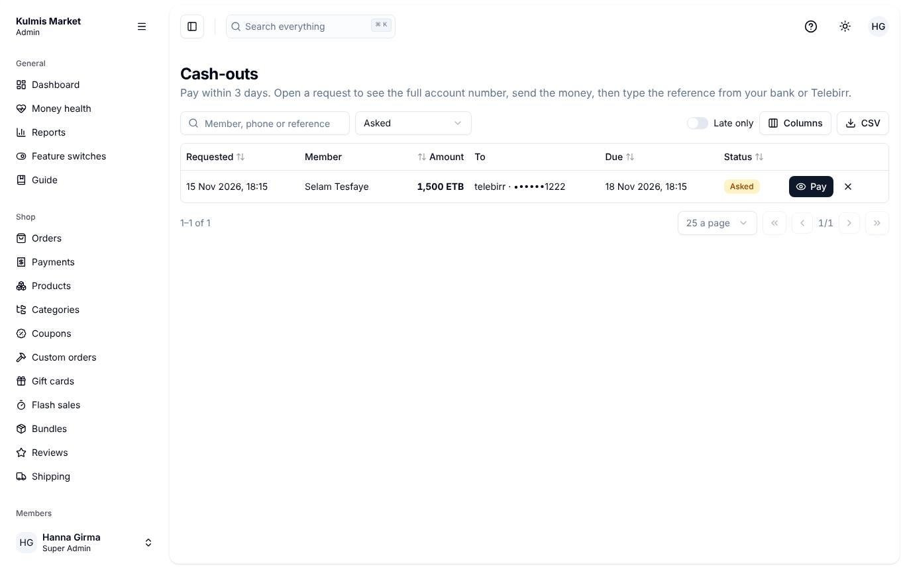

**Pay a cash-out** (pay within {payout_days} days)
1. **Cash-outs** → the list shows the ones due first.
2. **Pay** → check the account. The first time for a new account, tick **I checked the account** (the name Telebirr or the bank shows must match the member).
3. Send the money from your Telebirr or bank app.
4. Type the **reference** → **I sent it — mark paid**. The member gets a message.

Not right? **Do not pay, put money back** with a reason: the money goes back to their wallet.

**Safety rules (automatic)**
| Rule | Value |
|---|---|
| Smallest cash-out | {cashout_min} |
| Wait after a new or changed cash-out account | {account_hold_hours} hours |
| Most per 24 hours | {cashout_daily_count} requests, {cashout_daily_max} |
| The account name | must match the member's name |
| First cash-out of a new account | held for a check |

**Fraud checks**: the shop flags things like several accounts from one phone, paying with your own cash-out account, or too many sign-ups in a day. While a flag is open, that member's earnings wait and cash-outs are held.
- **Review** the flag and look at the details (same device, same phone, same account…).
- Real family or shop phone? **It's fine — clear and release holds**.
- Cheating? Type a note → **Confirm fraud** (tick **Also suspend the account** if needed).

**Money history**: every movement of money, for checks. **Fixes by hand** go here with a reason.

**Check**: every day cash-outs due; every week the fraud queue.
