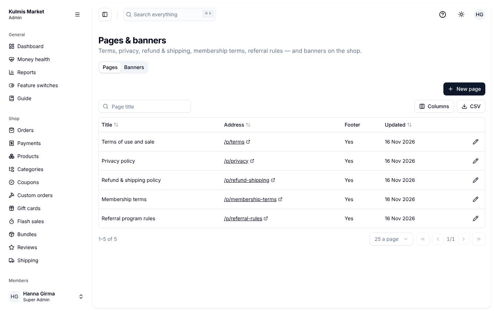

| What | Where |
|---|---|
| Shop name, short line under it, contacts | Settings → **Site** (or the setup wizard, page 2) |
| Logo | Setup wizard, page 2 → **Upload logo** (PNG, JPG or WebP; square works best) |
| Main colour of the shop | Settings → **Appearance** → Shop main colour |
| Colour of the member area | Settings → **Appearance** → Member area accent colour |
| Pages (terms, privacy, refunds, membership terms, referral rules) | **Pages & banners** |
| Announcement bar at the top of the shop | **Pages & banners** → Banners → place *top bar* |
| Help articles and questions | **Help centre** → Articles / Questions |
| Messages (SMS, email, Telegram texts) | Settings → **Messages** |

**Tips**
- Use `{if signals}…{/if}` around words about a feature that may be switched off. The shop then hides them automatically.
- In help articles, write numbers as `{membership_price}`, `{cashout_min}`… so they are always right. The editor lists all of them.

