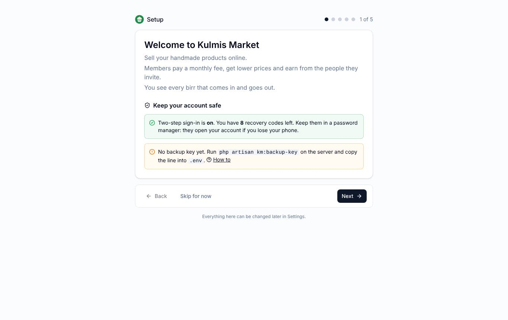

1. Open `https://your-domain/admin` and sign in with the account you made with `km:create-admin`.
2. **Two-step sign-in (2FA)** is required for all staff. Scan the QR code with Google Authenticator, Authy or your password manager and type the 6-digit code.
3. **Save the 8 recovery codes** in your password manager. Each one opens your account once if you lose your phone.
4. The **setup wizard** opens (5 short pages). It helps with your shop name, logo, colour, prices and services. You can skip any page and come back later: **Settings → Run setup again**.
5. After the wizard, the dashboard shows **Before you go live: … still to do** until everything is done.

**Backup key**: run `php artisan km:backup-key`, put the line in `.env` and keep a copy in your password manager. Without it nobody (not even you) can open a backup. See [Backups](setup-backups.md).

**More staff**: `php artisan km:create-admin name@example.com --role=finance` (roles: manager, finance, fulfilment, support). See [Staff and safety](daily-staff-security.md).
