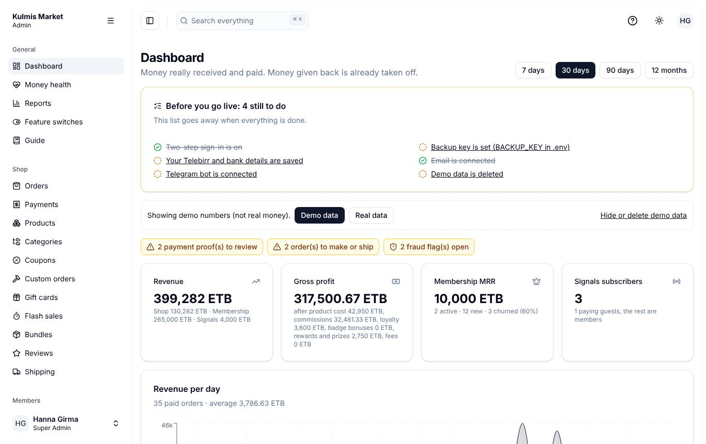

Do these in order. Tick each one.

- [ ] `.env`: `APP_ENV=production`, `APP_DEBUG=false`, `APP_URL=https://…`
- [ ] **Demo data deleted**: Admin → **Demo data** → Delete all demo data. This also deletes the demo accounts.
- [ ] **Test tools are off**: `km:story` and `km:test-clock` only work when `APP_ENV=local`. On the live shop they refuse to run.
- [ ] **Your own Telebirr and bank details** saved (Settings → Payments).
- [ ] **Email** works (setup wizard → Test).
- [ ] **Backup key** set, and `php artisan km:backup` made a file.
- [ ] **Cron line** added (Admin → Status → Background work shows a recent run).
- [ ] `php artisan km:doctor` → **all green** (no red ✘).
- [ ] Every staff account has 2FA on.
- [ ] **Test one real small payment**: buy a cheap product with your own phone, send a real Telebirr receipt, approve it, check the order turns **Paid** and the messages arrive. Then refund it.
- [ ] The dashboard list **Before you go live** is gone (everything done).

